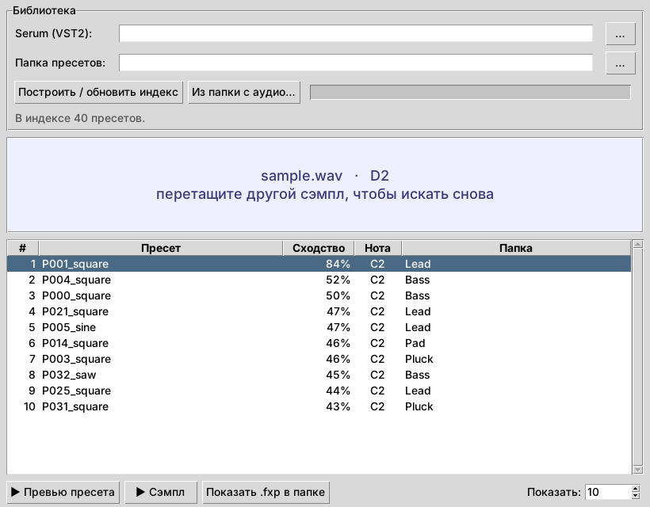

# Serum Matcher — поиск похожих пресетов Serum по сэмплу

Закидываешь сэмпл → программа анализирует звук → показывает пресеты
из **твоей** библиотеки Serum, которые звучат максимально похоже.



## Как это работает

1. **Индексация (один раз).** Программа загружает настоящий Serum (VST2) и
   прогоняет через него каждый пресет `.fxp`: играет ноты C1, C2, C3, C4 и
   снимает «отпечаток» звука. Плюс сохраняет короткое превью для прослушивания.
   При добавлении новых пресетов индекс обновляется: перерисовываются только
   новые и изменённые файлы.
2. **Поиск (мгновенно).** У сэмпла снимается такой же отпечаток и сравнивается
   с отпечатком каждого пресета, отрендеренным на ближайшей к сэмплу ноте.

Что входит в отпечаток:

| Аспект | Что измеряется |
|---|---|
| Обертоны | громкость 24 гармоник относительно основного тона — «форма волны», не зависит от высоты |
| Спектр, MFCC | общая окраска звука |
| Огибающая | атака, спад, сустейн (пэд / плак / бас) |
| Яркость во времени | движение фильтра |
| Шумность | шум, гармоничность, ширина спектра |
| Модуляция | LFO-«воблы» громкости и фильтра |

Высота сэмпла определяется автоматически и на результат почти не влияет:
бас в A1 найдёт пресет, отрендеренный на C1/C2.

## Установка на Windows 11 (готовая программа)

Python ставить не нужно.

1. Открой репозиторий на GitHub → **Actions** → **Build Serum Matcher for Windows**.
   Сборка запускается сама при каждом изменении программы; можно и вручную:
   **Run workflow**.
2. Открой последний успешный запуск (зелёная галочка) и внизу, в **Artifacts**,
   скачай `SerumMatcher-Windows`.
3. Распакуй ZIP в любую папку, например `C:\SerumMatcher`
   (не запускай прямо из архива).
4. Запусти `SerumMatcher.exe`.
   Если Windows покажет «Windows защитил ваш компьютер» — нажми
   **Подробнее → Выполнить в любом случае** (программа не подписана сертификатом).

<details>
<summary>Запуск из исходников (для разработчиков)</summary>

1. Python 3.11–3.13 (64-bit) с python.org, отметить «Add Python to PATH».
2. `install.bat`, затем `start.bat`.

macOS: `pip install -r requirements.txt`, затем `python3 -m serum_matcher`.
</details>

## Первый запуск

1. **Serum (VST2)** — путь к `Serum_x64.dll`, обычно
   `C:\Program Files\VSTPlugins\Serum_x64.dll` или
   `C:\Program Files\Common Files\VST2\Serum_x64.dll`
   (на macOS — `/Library/Audio/Plug-Ins/VST/Serum.vst`).
   Нужна именно VST2-версия: VST3 не умеет загружать `.fxp` извне.
2. **Папка пресетов** — обычно `Документы\Xfer\Serum Presets\Presets`.
   Подпапки (Bass, Lead, паки) становятся категориями.
3. **Построить индекс.** по оценке ~0,5–1 с на пресет, 2000 пресетов ≈ 20–30 минут.
   Можно остановить и продолжить позже — готовое сохраняется.
4. Перетащи сэмпл в окно (WAV, AIFF, FLAC, MP3, OGG).
   Двойной щелчок по результату — прослушать превью,
   «Показать .fxp в папке» — открыть файл, чтобы перетащить его в Serum.

Если какой-то пресет «роняет» Serum, программа сама перезапустится, пропустит
его и продолжит; такие пресеты перечислены в `crashed.txt` в папке индекса.
Индекс хранится в `%USERPROFILE%\SerumMatcher\index`.

## Командная строка

```
python -m serum_matcher index --serum "C:\Program Files\VSTPlugins\Serum_x64.dll" --presets "D:\Serum Presets"
python -m serum_matcher match kick_bass.wav --top 20 --explain
python -m serum_matcher match lead.wav --category Lead --category "Leads/Pack 2"
```

Из готовой программы то же самое: `SerumMatcher.exe match ...`
(вывод окна нет, поэтому добавь `--log-file out.txt`). Из исходников можно
просто перетащить сэмпл на `match.bat`.

* `--notes 48` — рендерить только C2 (в 4 раза быстрее, но хуже для сэмплов далеко от C2);
* `--no-previews` — не сохранять превью (экономит место: ~130 КБ на пресет);
* `--explain` — показать, по каким аспектам отличаются лучшие совпадения.

## Serum 2 и другие синтезаторы

Пресеты Serum 2 (`.SerumPreset`) нельзя загрузить в плагин извне. Для них
(и для любого другого синта) есть режим **«Из папки с аудио»**: отрендери
пресеты в DAW по одной ноте в файл (имя файла = название пресета, нота
~1,5 с) — программа проиндексирует папку.

## Ограничения — честно

* Лучше всего ищется **одиночная нота** одного синта. Сэмпл с аккордом,
  барабанами или эффектами микса сравнивается по общему тембру, точность ниже.
* Ищутся «похожие», а не «тот самый» пресет: если твоего звука нет в
  библиотеке, будут ближайшие по характеру.
* Пресеты, которым нужен внешний сигнал (FX-пресеты, вокодеры), пропускаются.
* Индексация на Windows с реальным Serum ещё не проверялась: алгоритм поиска
  проверен тестами на синтетической библиотеке (40 пресетов,
  сэмплы на других нотах и с изменённым фильтром/огибающей:
  ~80% — нужный пресет первым, 100% — в первой пятёрке).

## Проверка

```
pip install pytest
python -m pytest tests
```
